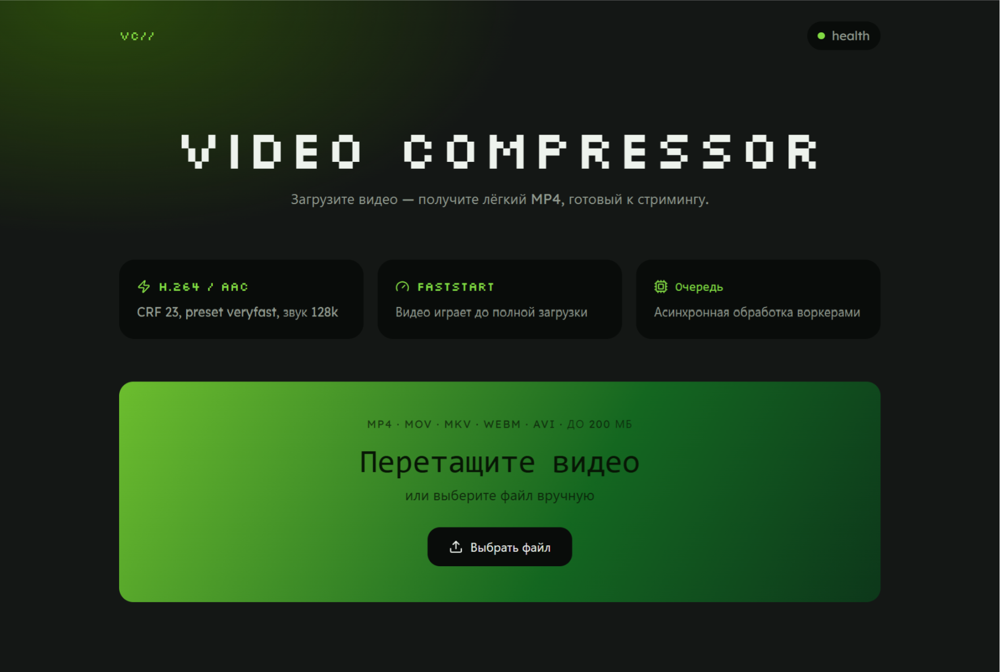
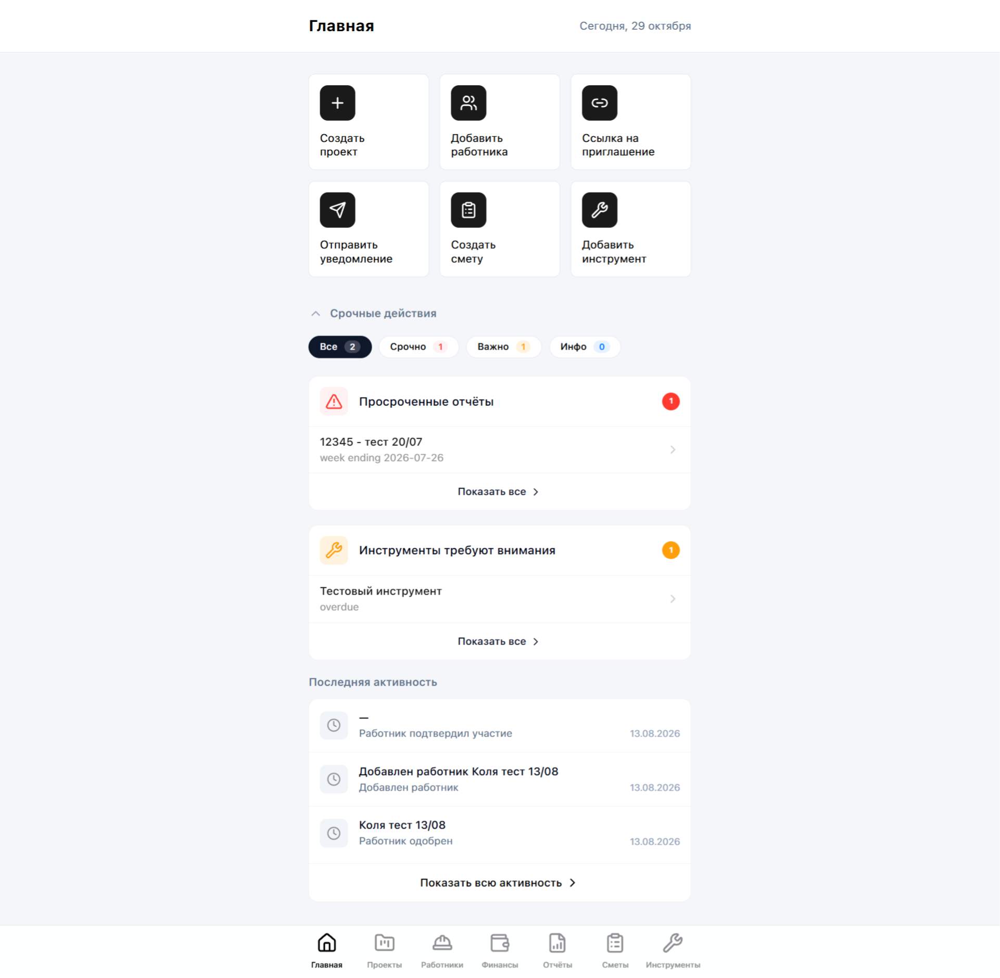
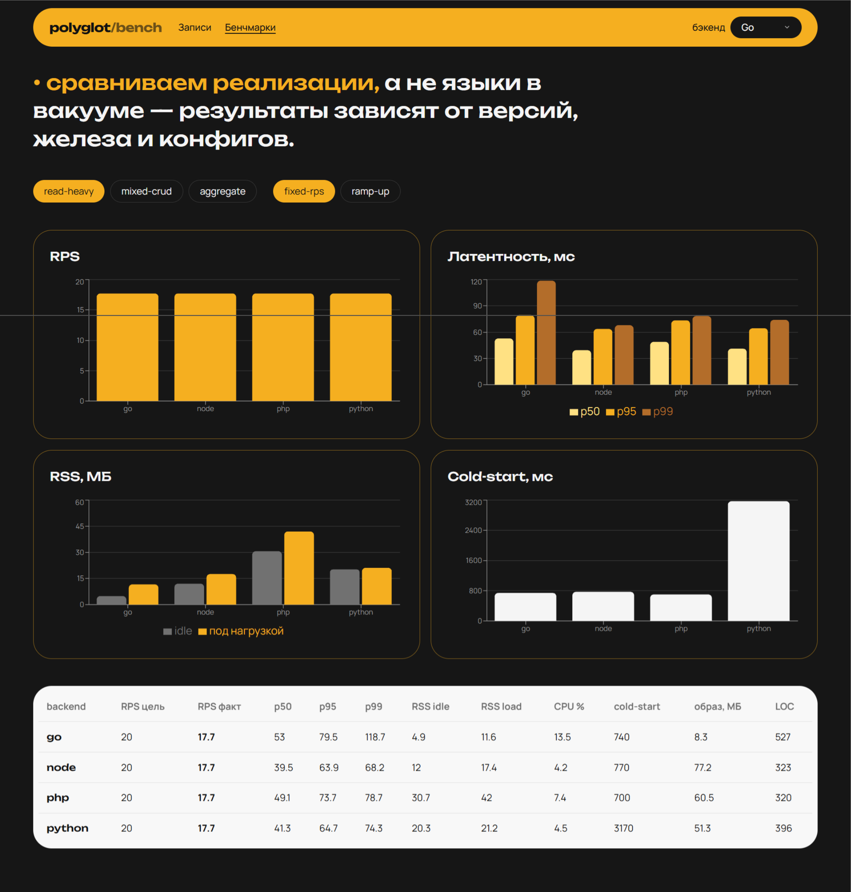
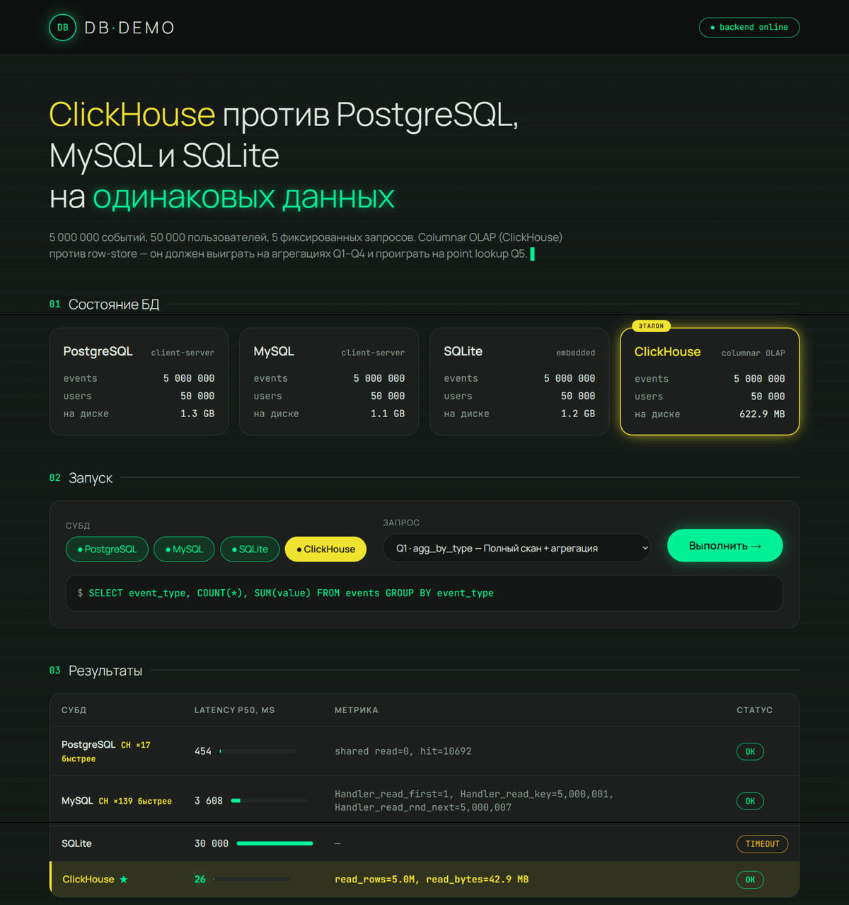
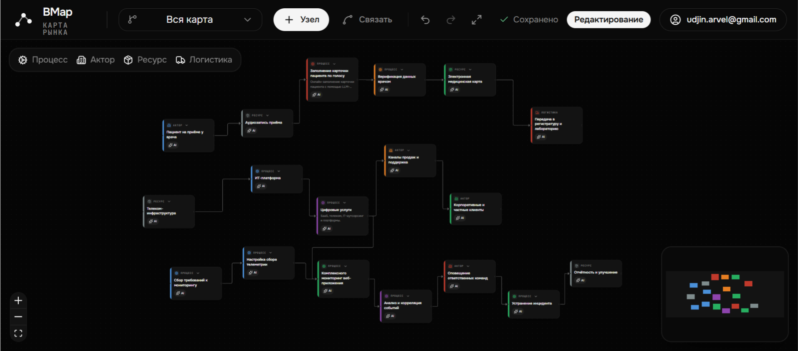

# Евгений Арвелов - Go-разработчик

Привет. Это подборка моих проектов на Go - бэкенды, микросервисы и замеры производительности. Основное портфолио со всем остальным (Python, PHP, фронтенд, DevOps) лежит в [соседнем репозитории](https://github.com/udjin-arvel/resume), а здесь только то, что относится к Go.

В коммерческой разработке я с 2016 года, начинал с PHP и Python. На Go пришёл за тем, за чем обычно и приходят: предсказуемая производительность, один бинарник, нормальная конкурентность из коробки и стандартная библиотека, которой часто хватает без фреймворков. Два проекта из пяти здесь как раз сделаны на чистом `net/http`.

Связаться: Telegram [@arvelov](https://t.me/arvelov), почта udjin.arvel@gmail.com.

## Проекты

- [Video Compressor](./vc-microservice) - микросервис сжатия видео, только стандартная библиотека. Загрузка потоком прямо на диск без буферизации в памяти, очередь на каналах с пулом воркеров FFmpeg, проверка сигнатур файлов, атомарная запись результата, graceful shutdown, отдача готовых файлов через nginx с Range. Около 30 тестов, включая интеграционный с настоящим FFmpeg.
- [Radar CRM](./network-manager-crm-web-app) - CRM для полевых команд: объекты, сметы с выгрузкой в PDF и XLSX, отчёты работников с расшифровкой голосовых, вход через Telegram WebApp. Gin, PostgreSQL, миграции, 65 тестов. Работает в браузере и как Telegram Mini App.
- [BMap](./bmap-web-app) - карта рынка в виде графа, живёт на [bmap.arvelov.space](https://bmap.arvelov.space). Neo4j для графа, SQLite для пользователей, JWT, WebSocket-хаб для живых обновлений, фоновые задачи, в которых DeepSeek достраивает цепочки.
- [Polyglot Backend Benchmark](./polyglot-backend-benchmark) - один и тот же API на Go, Node.js, PHP и Python по общему OpenAPI-контракту, с нагрузочными прогонами k6. Go-версия на `net/http` + pgx: образ 8 МБ и 5 МБ памяти в простое - меньше всех. Хотелось честно посмотреть, чем рантаймы отличаются при одинаковых условиях.
- [DB Demo](./db-demo) - ClickHouse против PostgreSQL, MySQL и SQLite на 5 млн строк. Бэкенд на chi с единым раннером поверх четырёх драйверов (pgx, go-sql-driver/mysql, modernc sqlite, clickhouse-go), таймауты через context, пакетная загрузка данных.

## Скриншоты

| Video Compressor | Radar CRM |
| --- | --- |
|  |  |
| **Polyglot Benchmark** | **DB Demo** |
|  |  |

**BMap** - [bmap.arvelov.space](https://bmap.arvelov.space)

## Что есть в этих проектах

`net/http` с паттернами маршрутизации Go 1.22, Gin и chi. PostgreSQL через pgx, ClickHouse, MySQL, SQLite, Neo4j. Конкурентность: пулы воркеров на каналах, `context` для таймаутов и отмены, graceful shutdown. WebSocket, JWT, фоновые задачи. Структурные логи через `slog`. Тесты на `testing` и `httptest`, интеграционные тесты с реальными зависимостями. Всё упаковано в Docker и поднимается одной командой, в Polyglot есть CI на GitHub Actions.

У каждого проекта свой README: зачем он нужен, как устроен и как запустить.
